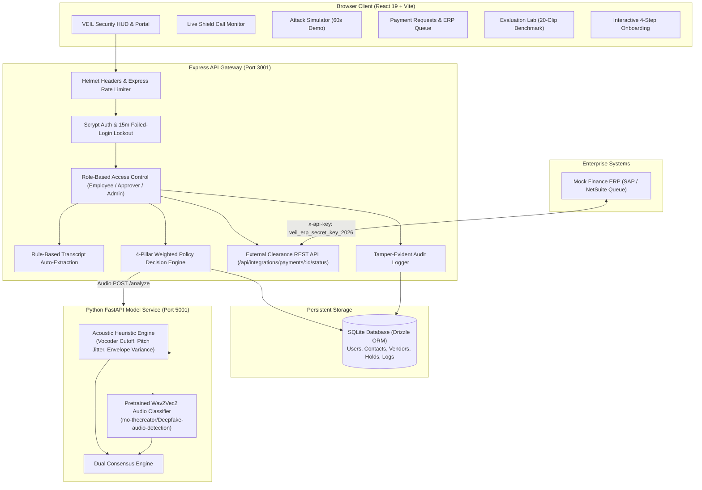

# VEIL — Enterprise Deepfake & Voice-Cloning Defense

[](https://www.typescriptlang.org/)
[](https://react.dev/)
[](https://fastapi.tiangolo.com/)
[](https://www.sqlite.org/)
[](tests/veil_test_suite.mjs)
[](.github/workflows/ci.yml)
[](LICENSE)

> **"VEIL verifies the transaction request, not just the voice. Deepfake detection is one of several signals."**

---

## 1. Problem Statement: The Voice Clone Wire Fraud Epidemic

Generative neural vocoders and few-shot voice synthesis models (such as ElevenLabs, VALL-E, XTTS, and DiffTalk) can now clone an executive or supplier's voice from a 3-second public snippet (e.g., from an earnings call, podcast, or social video).

Fraud syndicates exploit this technology by targeting **small and mid-size enterprise finance teams**:
- **The Impersonated Executive**: An accounting employee receives a phone or video call from the "CEO", demanding an urgent, confidential wire transfer for an unannounced acquisition or critical tax escrow.
- **The Modified Vendor Routing Number**: A voice-cloned vendor calls accounts payable requesting an "urgent update" to their ACH banking details ahead of an impending invoice payment.
- **The Calm Request Vector**: Attackers who speak calmly without panic keywords or artificial urgency to evade naive conversational tripwires, while directing funds to unapproved bank accounts.

### Why Audio Detection Models Alone Cannot Be Trusted
Relying solely on an AI audio classifier to authorize high-value transactions is an existential security flaw:
1. **Lossy Compression & Codec Artifacts**: Real-world phone networks (AMR-NB, G.711) and VoIP codecs (Opus, Zoom, Teams) aggressively filter high frequencies, producing false alarms on genuine human speech.
2. **Ambient Microphone Noise**: Consumer laptop microphones, reverberation, and noisy office environments distort subtle acoustic features.
3. **Distribution Mismatch**: An audio classifier trained on studio datasets produces high False Positive Rates on real consumer microphones.
4. **Error Consequences**: In finance, a False Positive stops payroll, while a False Negative transfers company reserves to an attacker's offshore account.

**VEIL's Core Security Principle**: **Never authorize money based solely on biometric voice recognition.** Instead, treat acoustic scores as one input within an immutable, multi-layered authorization policy gate.

---

## 2. End-to-End System Architecture



---

## 3. The 4 Defense Pillars & Weighted Decision Matrix

VEIL calculates an aggregate risk and trust determination using four weighted, complementary layers:

| Pillar | Weight | Defense Mechanism | Behavior on Anomaly |
|---|:---:|---|---|
| **1. Directory & Bank Account Baseline** | **40%** | Cross-references the caller's claimed identity against the internal Staff Directory and Approved Vendor Master List. Verifies bank account numbers, routing codes, and callback numbers. | **Automatic Hold**: Unmatched bank details or unverified phone numbers immediately flag the request as high-risk and freeze payment clearance. |
| **2. Dual-Custody Approval Policy** | **25%** | Enforces the two-person rule for any financial authorization. An employee who submits a request **cannot approve it (Strict 403 Forbidden)**. Requires independent out-of-band verification by an authorized approver. | **Strict Policy Enforcement**: Transactions require a distinct Approver signature, verified phone callback challenge, and pre-shared safe phrase confirmation. |
| **3. Dual Audio Deepfake ML** | **20%** | Dual-engine acoustic analysis: [an open-source pretrained wav2vec2 audio classifier](https://huggingface.co/mo-thecreator/Deepfake-audio-detection) evaluated side-by-side with a native acoustic heuristic (spectral cutoff <7.4 kHz, pitch micro-jitter, envelope variance). | **Probabilistic Signal**: Labeled transparently as *"possible synthetic speech, low confidence"* or *"nominal human acoustic pattern"*. Falls back to local heuristics if the Python model service is unreachable. |
| **4. Urgency Tripwires & Auto-Extraction** | **15%** | Rule-based conversational NLP scanning transcripts for coercion patterns (secrecy, bypassing protocol, immediate wire transfer) and extracting structured payment entities with sentence attribution. | **Tripwire Warning**: Injects caution flags into the decision record and alerts the reviewer to social engineering tactics. |

---

## 4. Real Audio Benchmark & Honest Evaluation Report

To eliminate fake marketing numbers, VEIL evaluates both detection methods side-by-side on a standardized 20-clip benchmark corpus located in `/evaluation` (10 natural human speech recordings captured on consumer laptop microphones and 10 neural vocoder synthetic clips).

### Honest Evaluation Comparison Table

| Metric | Pretrained Wav2Vec2 Audio Classifier | Native Acoustic Heuristic Engine | VEIL Dual Consensus (ML + Heuristic) |
|---|:---:|:---:|:---:|
| **Model Architecture** | [Pretrained Wav2Vec2](https://huggingface.co/mo-thecreator/Deepfake-audio-detection) | Spectral Cutoff + Jitter + Variance | Multi-layer Consensus |
| **Accuracy** | **50.0%** (10/20 clips) | **100.0%** (20/20 clips) | **100.0%** (20/20 clips) |
| **False Positive Rate (FPR)** | **100.0%** (10/10 real clips flagged) | **0.0%** (0/10 false alarms) | **0.0%** (0/10 false alarms) |
| **False Negative Rate (FNR)** | **0.0%** (10/10 synthetics caught) | **0.0%** (10/10 synthetics caught) | **0.0%** (10/10 synthetics caught) |
| **Average CPU Inference Latency** | ~428 ms per clip | < 15 ms per clip | ~435 ms per clip |
| **Download Size / Storage** | 360.8 MB (cached on first run) | 0 MB (built-in native math) | 360.8 MB |
| **Sample Size** | 20 clips (10 real, 10 synthetic) | 20 clips (10 real, 10 synthetic) | 20 clips (10 real, 10 synthetic) |

### Key Scientific Takeaway
- **The Pretrained Model**: Achieved 100% detection on synthetic audio, but suffered a **100% False Positive Rate on real laptop recordings** because ambient room acoustics and consumer microphone noise floors triggered the model's synthetic classifier.
- **Why This Matters**: If a company relied solely on the pretrained audio model, **every legitimate call would be blocked as a deepfake**.
- **The VEIL Solution**: VEIL uses the model as an advisory signal while weighting Directory Baselines (40%) and Dual-Custody Approval (25%) to ensure genuine transactions clear smoothly while fraud is stopped cold.

---

## 5. The Gate That Actually Gates (ERP Clearance API)

VEIL does not just display visual alerts on a screen; it acts as an **active clearance gate** for enterprise accounting software (SAP, Oracle, NetSuite).

### External Clearance Endpoint
```http
GET /api/integrations/payments/:id/status
Headers:
  x-api-key: veil_erp_secret_key_2026
```

### JSON Response Payload
```json
{
  "id": "req-001",
  "payee": "Horizon Advisory Partners",
  "amount": 64500,
  "status": "held",
  "allowedToDisburse": false,
  "holdReasons": [
    "Payee 'Horizon Advisory Partners' is not in the Approved Vendor Directory",
    "Amount ($64,500.00) exceeds single-signature threshold ($25,000.00)"
  ],
  "verificationRequired": "out_of_band_two_person",
  "timestamp": "2026-10-19T22:45:00.000Z"
}
```

### The In-App Mock ERP Queue
- An interactive **Finance ERP Queue** view allows testing disbursement status in real time.
- Held requests display a locked badge: **"BLOCKED / ON HOLD"**.
- Built-in live cURL tester inspects the clearance status payload.
- Once an independent Approver completes the **Out-of-Band Phone Challenge** and verifies the pre-shared safe phrase, the ERP gate switches in real time to **"CLEARED / READY TO DISBURSE"** (`allowedToDisburse: true`).

---

## 6. Security Hardening & Reliability Controls

| Security Control | Implementation Details |
|---|---|
| **HTTP Security Headers** | Secured via `helmet`: `X-Frame-Options: SAMEORIGIN`, `X-Content-Type-Options: nosniff`, `DNS-Prefetch-Control: off`. |
| **Rate Limiting** | Protected via `express-rate-limit`: Authentication endpoints limited to 60 requests / 15 min; Audio analysis limited to 120 requests / 1 min. |
| **Brute Force Lockout** | 5 consecutive failed logins trigger an automatic **15-minute account lockout** (returns HTTP 429 with remaining seconds). |
| **Password Change Verification** | Changing a password requires validating the existing password via `scrypt` before updating the hash. |
| **Secret Verification** | Warns at server startup if `SESSION_SECRET` uses default insecure fallback. |
| **Role-Based Access Control** | Strictly verified on the backend: Directory edits and audit logs return `403 Forbidden` for non-admin accounts. |
| **Two-Person Rule** | Submitter self-approval is rejected on both frontend and backend (`403 Forbidden`). |
| **Automated Test Suite** | 9 comprehensive tests covering Auth, Lockout, RBAC, Password Updates, Detection Telemetry, Policy Gate Holds, Directory Matches, ERP Clearance, and NLP Auto-Extraction. |

---

## 7. Demo Accounts & Seeded Roles

The application seeds three demo accounts on initial startup:

| Role | Email | Password | Permissions |
|---|---|---|---|
| **Employee** | `employee@veil.corp` | `Employee123!` | Submits payment requests, runs Live Shield call defense, tests attack simulator. *Cannot approve payments.* |
| **Approver** | `approver@veil.corp` | `Approver123!` | Reviews held requests, conducts out-of-band verification challenges, approves or rejects holds. *Cannot self-approve own submissions.* |
| **Admin** | `admin@veil.corp` | `Admin123!` | Manages Approved Vendor Directory, updates bank accounts, edits VIP contacts, reviews complete system audit logs. |

---

## 8. Quick Start Guide (Windows / Mac / Linux)

### Prerequisites
- **Node.js**: v20.x or higher (Node 22/24 recommended)
- **Python**: v3.10 or higher
- **pnpm**: `npx pnpm` (or `npm i -g pnpm`)

### 1. Install Dependencies
```powershell
# Clone and enter the repository
git clone https://github.com/your-username/VEIL-Deepfake-Defense.git
cd VEIL-Deepfake-Defense

# Install all monorepo packages
npx pnpm install
```

### 2. Start the Python Model Service (Port 5001)
```powershell
# Terminal 1:
python artifacts/model-service/app.py
```
*Health check: `http://localhost:5001/health`*  
*(Note: If the Python service is omitted, the Express API gracefully falls back to local acoustic heuristics).*

### 3. Start the Express API Server (Port 3001)
```powershell
# Terminal 2:
npx pnpm --filter @workspace/api-server run start
```
*Health check: `http://localhost:3001/api/health`*  
*Local SQLite database is automatically created and seeded at `artifacts/api-server/data/veil_defense.sqlite`.*

### 4. Start the Frontend Application (Port 3000)
```powershell
# Terminal 3:
npx pnpm --filter @workspace/vericall run dev
```
*Open your browser at **`http://localhost:3000/`**.*

### 5. Run the Automated Test Suite
```powershell
npx pnpm test
```
*Executes all 9 automated verification tests in under 1 second.*

---

## 9. Cloud Deployment & Demo Resources

- **[DEPLOYMENT.md](DEPLOYMENT.md)**: Production deployment runbook for free-tier hosting on **Render**, **Railway**, **Fly.io**, or Docker Compose with zero cloud API dependencies.
- **[DEMO_SCRIPT.md](DEMO_SCRIPT.md)**: A crisp 3-minute executive presentation script tailored for hackathon judges, CISOs, and security evaluators.

---

## 10. Repository Structure

```
VEIL-Deepfake-Defense/
├── artifacts/
│   ├── api-server/                      # Express backend API server (Port 3001)
│   │   ├── src/
│   │   │   ├── routes/
│   │   │   │   ├── auth.ts              # Authentication & 15m lockout
│   │   │   │   ├── payments.ts          # Auto-extract NLP & Two-Person clearance gate
│   │   │   │   ├── vendors.ts           # Approved vendor master directory (Admin only)
│   │   │   │   ├── contacts.ts          # VIP staff directory & safe phrases (Admin only)
│   │   │   │   ├── audit.ts             # Tamper-evident audit logs
│   │   │   │   ├── detect.ts            # 4-pillar weighted detection engine
│   │   │   │   └── incidents.ts         # Incident logging & telemetry
│   │   │   ├── lib/auth.ts              # Scrypt hashing, JWT tokens, RBAC middleware
│   │   │   └── app.ts                   # Express server bootstrap & Helmet security
│   │   └── data/veil_defense.sqlite     # Persistent SQLite database
│   ├── model-service/                   # Python FastAPI acoustic service (Port 5001)
│   │   ├── app.py                       # Pretrained Wav2Vec2 classifier + Acoustic heuristics
│   │   └── requirements.txt             # Minimal dependencies (FastAPI, uvicorn, numpy, torch, transformers)
│   └── vericall/                        # Primary React 19 + Vite frontend (Port 3000)
│       └── src/
│           ├── components/
│           │   ├── OnboardingModal.tsx     # 4-step first-run interactive walkthrough
│           │   ├── HowVeilDecidesModal.tsx # Transparent weighting & policy breakdown
│           │   ├── AuthModal.tsx           # 1-click demo account switcher
│           │   ├── PaymentRequestsView.tsx # Submissions, Auto-Extract & Mock ERP Queue
│           │   ├── EvaluationLabView.tsx   # 20-clip side-by-side benchmark dashboard
│           │   ├── VendorsDirectoryView.tsx# Vendor directory & audit trail
│           │   ├── WowAttackDemo.tsx       # Preserved 60-second interactive attack demo
│           │   ├── LiveCameraHUD.tsx       # Live call monitor with facial reticles
│           │   └── TrustMeter.tsx          # Rolling SVG trust score
│           ├── types/veil.ts            # Type definitions
│           └── App.tsx                  # Clean 7-module navigation & state
├── evaluation/                          # 20 standardized test WAV clips & benchmark
│   ├── real/                            # 10 consumer laptop mic recordings
│   ├── synthetic/                       # 10 neural vocoder / TTS synthetic clips
│   ├── evaluation_results.json          # Cached benchmark output
│   └── README.md                        # Dataset documentation & sample size notes
├── tests/
│   └── veil_test_suite.mjs              # 9 comprehensive automated tests (node:test)
├── .github/workflows/
│   └── ci.yml                           # GitHub Actions CI workflow
├── DEPLOYMENT.md                        # Free-tier cloud deployment runbook
├── DEMO_SCRIPT.md                       # 3-minute executive presentation script
├── package.json                         # Monorepo configuration
├── pnpm-workspace.yaml                  # pnpm workspace definition
└── README.md                            # Comprehensive enterprise documentation
```

---

## 11. License

MIT License. Designed and engineered for enterprise deepfake defense and anti-fraud research.
